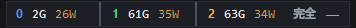
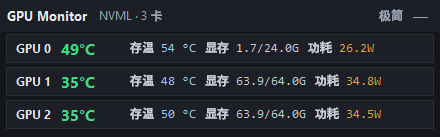
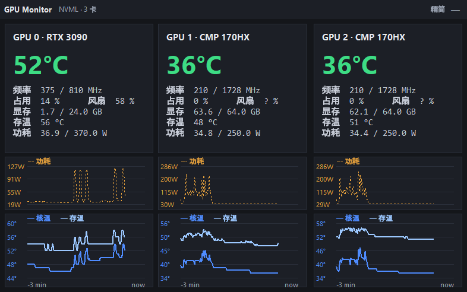
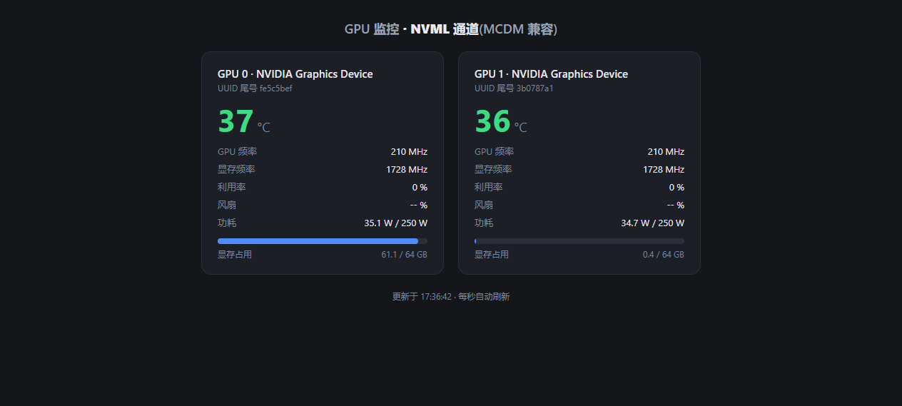

# GPU Monitor

[](https://github.com/hongguifeng/cmp170hx-gpu-monitor/actions/workflows/build-exe.yml)

A small GPU monitoring utility for **CMP 170HX × 2 in MCDM mode**; ordinary GeForce cards
in the same machine (e.g. an RTX 3090) are shown as well.

📖 Chinese documentation: [README.md](README.md) · this file is the English version.

**Download the exe**: the rolling pre-release **[ci-latest](https://github.com/hongguifeng/cmp170hx-gpu-monitor/releases/tag/ci-latest)** — its asset is the `GPU-Monitor.exe` packaged by CI (public download, no login, replaced on every push to `master`).

In MCDM mode, NVAPI-based tools (GPU-Z, LibreHardwareMonitor, ...) **cannot see the two CMP cards at all**.
This tool talks over the **NVML channel** (the same source `nvidia-smi` uses) for them, so it reliably reads
core temperature, HBM memory temperature, power draw and VRAM usage — and it reconnects by itself
after the NVIDIA driver is uninstalled and reinstalled (the unlock procedure keeps swapping the driver).
For an ordinary GeForce card in the same machine it additionally uses NVAPI to read the GDDR6X
memory-junction temperature.

## UI preview

System tray icon — always shows the temperature of the **hottest GPU** and changes colour with it
(green &lt; 68°C · orange ≥ 68°C · red ≥ 80°C):


Always-on-top floating window · ultra mode (every GPU squeezed onto one line, memory in use in bold
plus power draw, and not even a title bar):



Always-on-top floating window · compact mode (one row per GPU, stays out of the way):



Always-on-top floating window · full mode (one card per GPU + two stacked 3-minute charts: the upper
one carries the power draw on a watt scale of its own, the lower one core temp and memory temp on
one shared degree scale; every card shares one palette -- blue = core temp, pale blue = memory temp,
dashed amber = power -- so the cards are told apart by the card itself rather than by colour):



Web dashboard (`gpu-monitor.py`, optional, see below):



## Features

- **Tray-resident** — the icon shows the current maximum temperature in real time; a single click on the
  tray icon shows / hides the floating window
- **Always-on-top floating window** — one button cycles three layouts
  (full → compact → ultra → full; the button is labelled with the layout the next click gives you);
  `—` hides it; drag it to move; the preference persists across restarts (`compact.flag`: no file =
  full, empty file = compact, the word `ultra` inside = ultra, so old flag files keep working)
  - **ultra mode is a single line with no title bar at all**: every GPU shares that one line and keeps
    only the memory in use (bold, whole gigabytes, e.g. `12G`) and the power draw (whole watts, e.g.
    `250W`, rolling over to `1kW` past 1000W). Cards are told apart by their index, each painted in its
    own colour (blue / green / amber) purely to tell one cell from the next -- the full-mode curves no
    longer change colour per card. Any part of the line drags the window, and `—` plus the layout button
    live at its right end; **every card gets a cell of exactly 90px** (sized to the widest reading we
    expect -- `99G` memory plus `999W` draw, with nothing left over), split apart by a 2px divider that
    is brighter than the box border, so a figure growing or shrinking on one card never shifts another
    card's numbers (3 cards = 356px, 1 card = 176px) and the height stays 28px
  - by default it sits flush in the bottom-right corner: its right edge on the screen edge and its
    bottom edge on the taskbar's top (it follows the taskbar's height and docked side)
  - **z-order** — always above ordinary windows but below the taskbar, so dragging it over the
    taskbar area never covers the Start button / tray / clock; if the taskbar itself is not a
    topmost window (some fullscreen / remote-desktop / Explorer-restart states), the widget falls
    back to plain topmost rather than ending up under ordinary windows
  - **but it is never swallowed whole**: once the taskbar would cover 60% of it, or leave less than
    12px sticking out (nothing to aim at), the widget climbs back on top of the taskbar so it stays
    clickable, and returns below it on the next tick once it is dragged clear (log keywords
    `keeping it above` / `below taskbar`)
  - resizes (switching layout or a change in the GPU count) are anchored to the **bottom-right**
    corner, so a window you placed stays exactly where you put it
  - after a display resolution / monitor switch the window is re-placed and always ends up inside
    the desktop (log keyword `display change`)
- **Per-GPU readings** (NVML) — name, core temperature, GPU / memory clocks, utilisation, fan,
  VRAM usage, live power draw and power limit
- **Full-mode layout scales with the GPU count** — one 250px column per card, so three GPUs get a
  786px-wide window instead of having the third column clipped outside the old fixed 524px window
- **Memory temperature (HBM / GDDR6X)** — HBM temp comes from a long-lived `nvidia-smi -l 1`
  streaming process parsing `temperature.memory` (entries expire after 5 seconds, which rules out
  "frozen" stale temperatures); Windows nvidia-smi reports `N/A` for GDDR6X cards such as the
  RTX 3090, so those are read through NVAPI's `NvAPI_GPU_GetThermalSensors` and matched to the
  NVML device by PCI bus number
- **Survives driver removal** — three self-healing paths: all readings dead, individual GPUs degraded,
  or the NVML device list gone stale (cross-checked against a fresh nvidia-smi enumeration); each of
  them forces NVML to be rebuilt, so monitoring comes back after a driver reinstall
- **Start on boot** — a tray menu checkbox writes the `HKCU\...\Run` key; it survives driver reconnects
- **Watchdog** — `watchdog.ps1` checks liveness every 10 seconds and restarts the process if it dies
  unexpectedly; once the tray menu "Quit" writes `no-restart.flag`, the watchdog honours that intent
- **Crash black box** — `faulthandler` plus a global `excepthook` send hard crashes and uncaught
  exceptions to `monitor.log`
- **Single instance** — a named mutex stops two copies from interfering with each other

## Usage

### Tray app (recommended)

Double-click `GPU-Monitor.exe` — no installation and no Python required.
On first run it is a good idea to tick "Start on boot" in the tray menu.

### Run from source

```bash
pip install pystray pillow
python gpu-monitor-tray.py
```

### Web dashboard (optional second form)

```bash
python gpu-monitor.py
# or start it without a visible console: double-click start-gpu-monitor.vbs
```

Open <http://127.0.0.1:8765> in a browser — it refreshes every second and shows temperature, clocks,
utilisation, fan, power / power limit, VRAM usage bars and the last characters of each GPU UUID.

## Files

| File | Purpose |
| --- | --- |
| `gpu-monitor-tray.py` | Main program: tray + floating window + NVML / nvidia-smi self-healing logic |
| `gpu-monitor.py` | Lightweight variant: NVML → local web dashboard (port 8765) |
| `watchdog.ps1` | Watchdog: restarts the process when it dies |
| `start-gpu-monitor.vbs` | Hidden launcher for the web dashboard |
| `GPU-Monitor.spec` | PyInstaller build configuration |
| `monitor.ico` | Application icon |
| `GPU-Monitor.exe` | Build output (not tracked in git) |

## Troubleshooting

All runtime diagnostics (NVML reconnects, GPU count changes, why a forced rebuild happened, crash
stack traces) are appended to `monitor.log` — that file is the first thing to look at when something
misbehaves.

## Rebuilding

```bash
pip install pyinstaller pystray pillow
pyinstaller GPU-Monitor.spec
```

The result is `dist/GPU-Monitor.exe`, which can replace the exe in the repository root.
To replace the running exe, stop the watchdog first (see [AGENTS.md](AGENTS.md)).

## Building in GitHub CI

The repository ships `.github/workflows/build-exe.yml`: pushing to `master`, opening a pull request,
pushing a tag, or running the workflow manually (Actions → "Build Windows EXE" → Run workflow) builds
`dist/GPU-Monitor.exe` on a `windows-latest` runner with PyInstaller using `GPU-Monitor.spec`, then
publishes it in two places:

| Where | What | Download requirements |
| --- | --- | --- |
| Artifacts on the workflow run page | `GPU-Monitor-windows`, kept for 30 days, expires | login to GitHub |
| GitHub Releases | push to `master` → rolling pre-release **`ci-latest`** (overwritten by every build); push a tag (`v*`) → a real release named after that tag | public, no login, never expires |

So a usable exe is available without any local toolchain — the Releases page is the better place to get it.

## Known limitations

- Graphs cover only the last **3 minutes** (180 one-second samples)
- `Fan %` is unavailable on some BIOS / driver combinations (shown as `-- %`)
- The floating window is borderless (`overrideredirect`): full and compact mode are dragged by their
  title bar, ultra mode has none, so you drag the line itself
